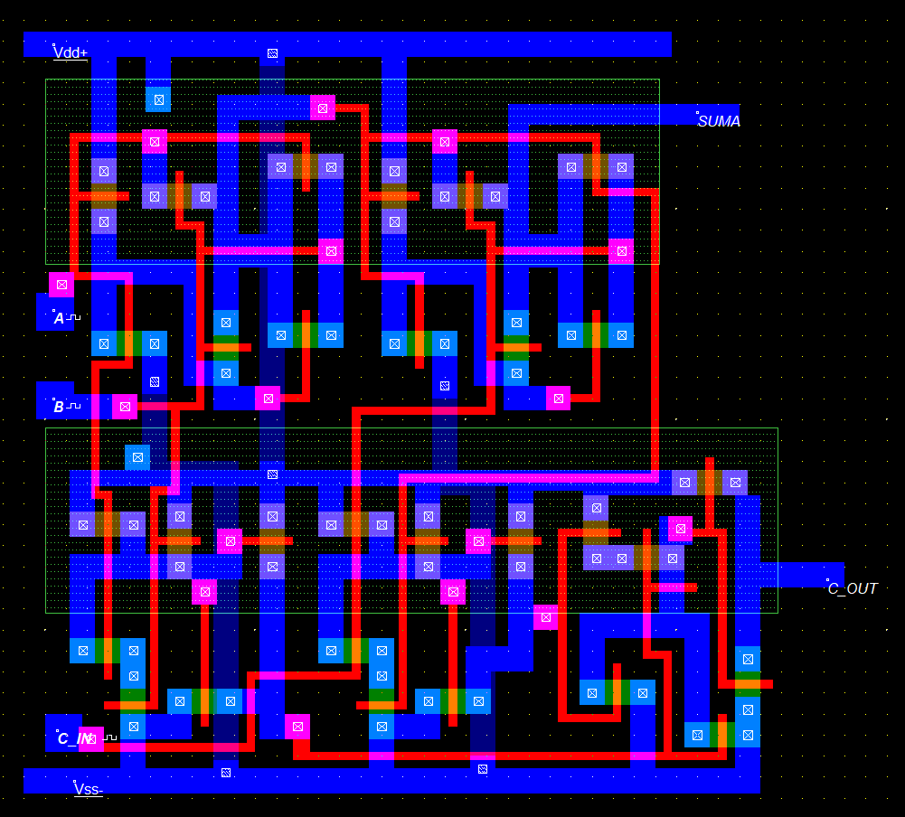
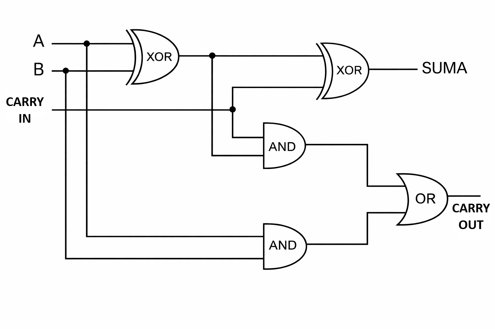
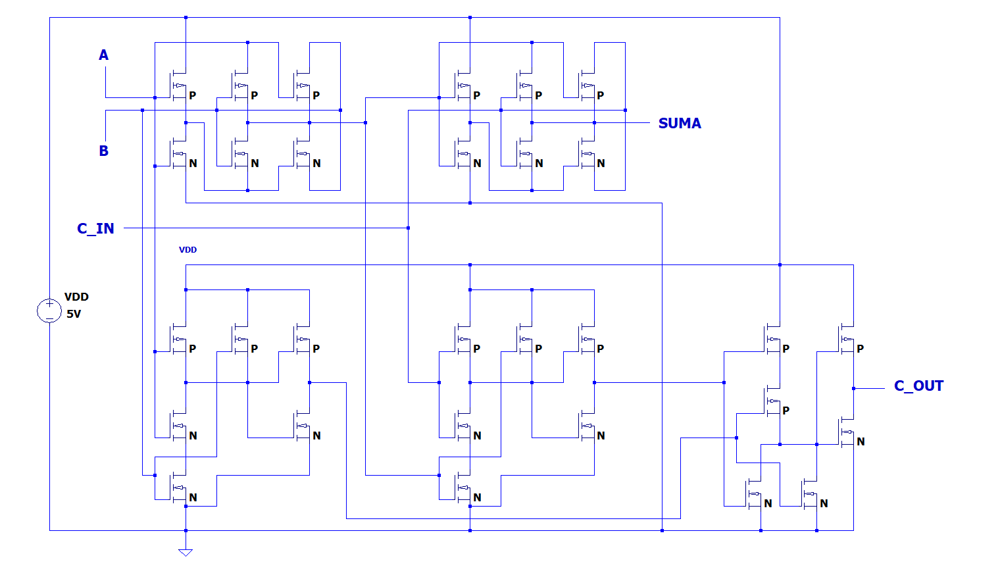
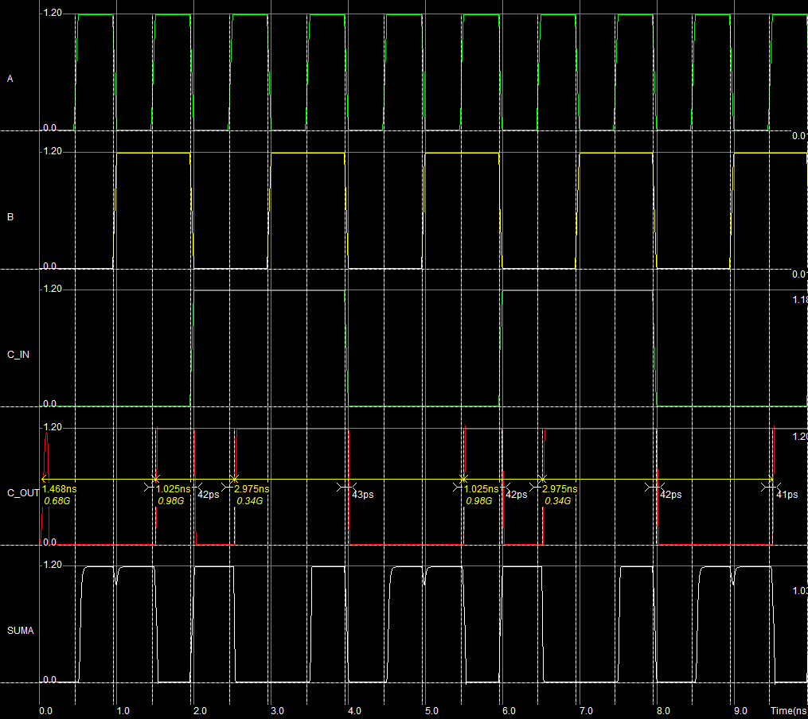

<div align="center">

# Potpuno zbrajalo realizirano CMOS tehnologijom

**Konstrukcijske vježbe iz kolegija Mikroelektronika**<br>
Fakultet elektrotehnike, računarstva i informacijskih tehnologija Osijek



</div>

---

## Sadržaj

1. [Uvod](#1-uvod)
2. [Logička shema](#2-logička-shema)
3. [Tablica istine](#3-tablica-istine)
4. [Električna shema](#4-električna-shema)
5. [Topološki nacrt](#5-topološki-nacrt)
6. [Rezultati simulacije](#6-rezultati-simulacije)
7. [Struktura repozitorija](#7-struktura-repozitorija)
8. [Pokretanje](#8-pokretanje)

---

## 1. Uvod

Potpuno zbrajalo (engl. *full adder*) je kombinacijski sklop koji zbraja tri binarne znamenke, odnosno dva ulazna bita **A** i **B** te ulazni prijenos **C_IN**. Na izlazu daje bit sume **SUMA** i izlazni prijenos **C_OUT**. Sklop je realiziran u CMOS tehnologiji, a projekt obuhvaća cijeli put od logičke i električne sheme do topološkog nacrta u programu Microwind i provjere rada simulacijom.

## 2. Logička shema

Izlaz SUMA dobiva se pomoću dvaju kaskadno spojenih XOR vrata. Izlaz C_OUT dobiva se pomoću dvaju AND vrata čiji se izlazi spajaju na OR vrata, pa je izlaz u stanju logičke jedinice kada su barem dva od tri ulaza aktivna.

<div align="center">

</div>

$$SUMA = A \oplus B \oplus C_{IN}$$

$$C_{OUT} = A \cdot B + C_{IN} \cdot (A \oplus B)$$

## 3. Tablica istine

<div align="center">

| A | B | C_IN | SUMA | C_OUT |
|:-:|:-:|:----:|:----:|:-----:|
| 0 | 0 |  0   |  0   |   0   |
| 0 | 0 |  1   |  1   |   0   |
| 0 | 1 |  0   |  1   |   0   |
| 0 | 1 |  1   |  0   |   1   |
| 1 | 0 |  0   |  1   |   0   |
| 1 | 0 |  1   |  0   |   1   |
| 1 | 1 |  0   |  0   |   1   |
| 1 | 1 |  1   |  1   |   1   |

</div>

## 4. Električna shema

Sve logičke funkcije ostvarene su komplementarnim parovima tranzistora. PMOS tranzistori čine pull-up mrežu spojenu na napajanje, a NMOS tranzistori pull-down mrežu spojenu na masu. Shema je izrađena u alatu LTspice.

<div align="center">

</div>

## 5. Topološki nacrt

Topološki nacrt izrađen je u programu Microwind i prati pravila projektiranja alata.

<div align="center">

| Parametar | Vrijednost |
|:--|:--|
| Broj tranzistora | 30 (15 NMOS i 15 PMOS) |
| Dimenzije nacrta | 195 × 181 λ |
| Alat | Microwind |
| Datoteka | [`Topoloski nacrt/FULL_ADDER_V4_FINAL.MSK`](Topoloski%20nacrt/FULL_ADDER_V4_FINAL.MSK) |


</div>

## 6. Rezultati simulacije

Ulazi A, B i C_IN zadani su kao pravokutni impulsi različitih perioda, pa simulacija obuhvaća sve kombinacije ulaznih stanja. Izlazi SUMA i C_OUT ponašaju se u skladu s tablicom istine, a mala kašnjenja na prijelazima posljedica su parazitskih elemenata topološke realizacije.

<div align="center">

</div>

## 7. Struktura repozitorija

```
.
├── README.md
├── Dokumentacija/
│   ├── Dokumentacija.tex            LaTeX izvor dokumentacije
│   ├── Dokumentacija.pdf            projektna dokumentacija
│   └── *.png                        slike korištene u dokumentaciji
├── Topoloski nacrt/
│   └── FULL_ADDER_V4_FINAL.MSK      konačni topološki nacrt (Microwind)
└── Slike/                           slike korištene u README datoteci
```

## 8. Pokretanje

1. Instalirati program **Microwind** (verzija 2 ili novija).
2. Otvoriti datoteku `Topoloski nacrt/FULL_ADDER_V4_FINAL.MSK` naredbom *File → Open*.
3. Pokrenuti simulaciju naredbom *Simulate → Run Simulation* i promatrati valne oblike signala A, B, C_IN, SUMA i C_OUT.

---

<div align="center">
<sub>Tomislav Perković · FERIT Osijek · 2026.</sub>
</div>
